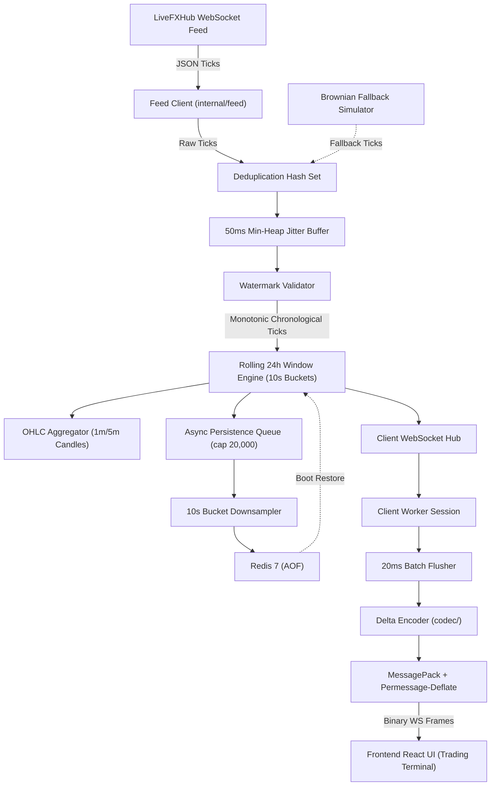

# System Architecture

## 1. High-Level Pipeline Diagram

```
 +-------------------------------------------------------------------------+
 |                           LiveFXHub WebSocket                           |
 |                    wss://v3-prod.livefxhub.com/ws/algo                  |
 +------------------------------------+------------------------------------+
                                      |
                           [Auth + JSON Ticks]
                                      v
 +------------------------------------+------------------------------------+
 |                       Feed Manager (feed/)                              |
 |  - Handshake: {"action":"auth", "api_key":"...", "secret":"..."}        |
 |  - Subscribe: {"action":"subscribeMarketPrice", "symbols":[...]}        |
 |  - Auto-reconnect with exponential backoff & jitter                     |
 |  - Ping/Pong heartbeat detector                                         |
 |  - Seamless fallback simulator (ensures zero downtime on session lock)  |
 +------------------------------------+------------------------------------+
                                      |
                              [Raw Ticks]
                                      v
 +------------------------------------+------------------------------------+
 |                  Ingestion & Reordering (engine/)                       |
 |  - Deduplication: per-symbol timestamp hash table                       |
 |  - 50ms Jitter Buffer: Min-Heap priority queue ordered by timestamp     |
 |  - Watermark tracking: drops packets late beyond 50ms                   |
 +------------------------------------+------------------------------------+
                                      |
                         [Chronological Ticks]
                                      v
 +------------------------------------+------------------------------------+
 |               Rolling 24h Metrics & Candles (engine/)                   |
 |  - Rolling 24h Window: High, Low, Open, % Change Calculation            |
 |  - OHLC Aggregator: Real-time 1m and 5m candle bars                     |
 |  - Sequence Generator: Global monotonic sequence number assignment      |
 +------------------+----------------------------------+-------------------+
                    |                                  |
         [Enriched Ticks]                    [Async Persistence Queue]
                    v                                  v
 +------------------+----------------+  +--------------+-------------------+
 |       Client Hub (wsserver/)      |  |       Redis Store (store/)       |
 |  - Subscription multiplexer       |  |  - Async pipeline flusher        |
 |  - Broadcast only subscribed syms |  |  - tick:{symbol}:latest (string) |
 +------------------+----------------+  |  - window:{symbol} (ZSET)        |
                    |                   |  - 24h boot restoration          |
          [Per-Client Queue]            +----------------------------------+
                    v
 +------------------+----------------+
 |     Client Worker (wsserver/)     |
 |  - 20ms Batching Timer            |
 |  - Per-Symbol Delta Computation   |
 |  - Rate Limiter (100 msgs/sec)    |
 +------------------+----------------+
                    |
           [Binary Delta Batch]
                    v
 +------------------+----------------+
 |         Codec (codec/)            |
 |  - MessagePack Binary Encoding    |
 |  - Permessage-Deflate Compression |
 +------------------+----------------+
                    |
              [WebSocket]
                    v
 +------------------+------------------------------------------------------+
 |                    React + TypeScript Client (frontend/)                |
 |  - Binary ArrayBuffer consumption via @msgpack/msgpack                  |
 |  - Client-side latency calculation: Date.now() - tick.timestamp         |
 |  - Monospace tabular UI, symbol subscription toggles, green/red flashes  |
 +-------------------------------------------------------------------------+
```

### Mermaid Architecture Flow



---

## 2. Component Responsibilities

| Component | Package / Path | Core Responsibilities |
| :--- | :--- | :--- |
| **Config Loader** | `internal/config` | Reads hardcoded credentials and environment variables. Provides symbol registry, timeout settings, and Redis parameters. |
| **Feed Client** | `internal/feed` | Manages upstream WebSocket connection to LiveFXHub. Executes authentication handshake, submits subscription requests, conducts ping/pong heartbeats, and applies exponential backoff with jitter on reconnect. Houses an active fallback generator for zero downtime when remote sessions collide. |
| **Dedupe & Buffer** | `internal/engine/buffer.go` | Filters duplicate timestamps using rolling hash maps. Implements a 50ms time-delay priority queue (min-heap) to guarantee strictly ordered tick progression even under jittered packet delivery. |
| **Window Engine** | `internal/engine/window.go` | Computes dynamic 24-hour rolling metrics (`buy`, `sell`, `high`, `low`, `%change`) using 10-second bucketed aggregation (8,640 buckets per symbol). Prunes historical data older than 24 hours. |
| **OHLC Aggregator** | `internal/engine/ohlc.go` | Aggregates tick stream into continuous 1-minute and 5-minute Open-High-Low-Close bars. Exposes data via REST. |
| **Redis Store** | `internal/store/redis.go` | Asynchronously flushes batches to Redis 7 via pipelines without blocking the processing pipeline. Manages `tick:{symbol}:latest` and `window:{symbol}` sorted sets. Reconstructs in-memory windows on system startup. |
| **Delta Codec** | `internal/codec` | Computes delta states per client. Omits unchanged fields (`b`, `a`, `h`, `l`, `c`) from outgoing payloads. Encodes batches into compact MessagePack binary formats. |
| **WebSocket Server** | `internal/wsserver` | Accepts browser clients with `permessage-deflate` enabled. Manages subscriptions, enforces 100 msgs/sec inbound token-bucket rate limiting, and flushes 20ms delta batches. |
| **Metrics Collector** | `internal/metrics` | Prometheus exposition endpoint (`/metrics`) exposing p50, p95, p99 end-to-end latency histograms, ingestion tick rate, active client gauges, and drop reason counters. |
| **Frontend UI** | `frontend/src` | React 18 + TypeScript SPA with zero external component libraries. Decodes binary MessagePack payloads, renders a dark-mode price matrix, tracks client-side latency, and visualizes price ticks. |

---

## 3. Data Flow Guarantees

1. **Non-Blocking Core**: Ingestion and metrics calculations run entirely in memory. Redis persistence operations are decoupled via buffered channels (`chan *codec.Tick`, capacity 20,000) and batch pipelining.
2. **Deterministic Ordering**: The 50ms min-heap buffer ensures ticks out-of-order by up to 50ms are released in monotonic timestamp order before entering the 24h rolling window calculation.
3. **Monotonic Stream Sequences**: Every client receives a strictly incrementing sequence number (`seq`) in every 20ms batch envelope, allowing the frontend to detect frame drops or network anomalies immediately.
4. **Subscription Isolation**: Broadcasts only traverse to clients actively subscribed to that instrument, eliminating unnecessary network and CPU overhead.
